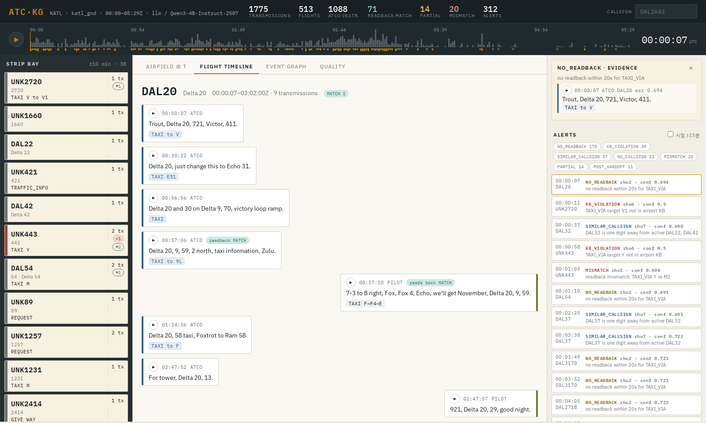

# ATC-KG: Event-Centric Temporal Knowledge Graph of U.S. ATC Radio Communications

> Team project for **XAI616-00 Knowledge-Based Systems** (Fall 2026, Department of Artificial Intelligence, Korea University) — Team 6.

**[Live demo → bigeco.github.io/atc-readback-kg](https://bigeco.github.io/atc-readback-kg/)**

[](https://bigeco.github.io/atc-readback-kg/)

The live demo is a static build of KATL Ground (2024-08-26, 00:00–05:30Z): a flight-strip board, a UTC time scrubber,
the airfield state at time *t*, two-lane radio logs with readback verdicts, per-flight event graphs, and evaluation results.
Audio playback is available only in the local server mode (`bash scripts/run_demo.sh`), because LiveATC audio may not be redistributed.

This repository turns raw VHF air traffic control audio (LiveATC) into an **event-centric temporal knowledge graph**.
On that graph it then checks **controller–pilot readbacks** and answers **time-aware situational-awareness queries**,
and a web demo presents the results.

- Problem definition and literature: `docs/problem_definition/`
- Formal module specification (M0–M9): `docs/system_design/system_module.pdf`
- Presentation write-up (Team 2 structure): `docs/report/team6_kg_report.pdf`

## Pipeline

| Stage | Module | Code | Output |
|---|---|---|---|
| M0 | Static airport KB (OurAirports + OpenStreetMap) | `src/kb/build_static_kb.py` | `data/static_kb/<icao>.json` |
| KB | Ontology + rule base from DLR v3.00 spec/table and FAA JO 7110.65BB (PDFs in `data/ontology/`, not redistributed) | `src/kb/build_ontology.py` | `configs/ontology.json`, `configs/rules.json` |
| M1 | Archive discovery, context from file names, facility filter, VAD | `src/pipeline/m1_ingest.py` | archive records |
| M2 | Context-biased Whisper large-v3 + hallucination filter + language id | `src/pipeline/m2_asr.py`, `src/run_asr.py` | `results/<run>/stt/` |
| M3 | Text-based speaker role and turn splitting | `src/pipeline/m3_role.py` | `turns.jsonl` |
| M4 | Ontology-grounded extraction (LLM few-shot + rule grammar, hybrid) | `src/pipeline/m4_extract.py`, `src/prompt/prompt.py` | `extraction.jsonl` |
| M5 | Callsign resolution (incl. number-only and misrecognized airlines), KB grounding | `src/pipeline/m5_canonicalize.py` | `canonical.jsonl` |
| M6 | Incremental bi-temporal event graph, readback linking, invalidation | `src/pipeline/m6_graph.py` | `kg/graph.json`, `kg/neo4j/` |
| M7 | Concept-level readback comparison and anomaly rules ρ1–ρ7 | `src/reasoning/rules.py` | `alerts.json` |
| M8 | Snapshot / timeline / competency queries | `src/reasoning/queries.py` | API + demo |
| M9 | Evaluation harness E1–E4 | `src/evaluation/` | `results/<run>/eval/` |

`src/build_kg.py` runs M3–M7; `src/run_asr.py` runs M1–M2.

## Layout

```
configs/                 ontology.json (vocabulary: DLR-based command types), rules.json (FAA/ICAO readback, supersession), airlines.json (telephony)
data/
  raw/liveatc/<airport>/<feed>/*.mp3   LiveATC archives (not committed)
  static_kb/<icao>.json                M0 output
  gold/                                hand-labeled sets for E4
docs/                    problem definition, system design (LaTeX), report (LaTeX)
scripts/                 setup, download, pipeline, eval, demo
src/
  common/  kb/  pipeline/  prompt/  reasoning/  evaluation/  demo/
results/<run>/           all generated artifacts (not committed)
```

## Quick start

```bash
bash scripts/setup_env.sh                     # conda env "atc-kg" (python 3.11, torch cu124)
bash scripts/download_liveatc.sh katl "Gnd"   # or put archives under data/raw/liveatc/<airport>/
bash scripts/build_static_kb.sh KATL
CUDA_VISIBLE_DEVICES=3 RUN_NAME=katl_gnd bash scripts/run_pipeline.sh
RUN_NAME=katl_gnd bash scripts/run_eval.sh
RUN_NAME=katl_gnd PORT=8800 bash scripts/run_demo.sh   # http://127.0.0.1:8800
```

To view the demo from a laptop when it runs on a remote server: `ssh -L 8800:127.0.0.1:8800 <server>`.

**Static demo (GitHub Pages)**: https://bigeco.github.io/atc-readback-kg/ — served from the `gh-pages` branch.
Rebuild and publish with `RUN_NAME=katl_gnd PUBLISH=1 bash scripts/export_site.sh`. The static site has no audio (LiveATC terms); playback works only in the local server mode.

Useful switches
- `build_kg.py --extractor rule` runs a GPU-free baseline. `--stt-from <run>` reuses another run's ASR output. `--reuse-extraction` skips M4.
- `run_asr.py --language auto --segment-lang` enables language identification for RQ4 (non-English segments become `UNSUPPORTED_LANG`).
- `build_kg.py --llm-backend openai --llm-base-url http://host:8000/v1` uses an OpenAI-compatible server instead.
  **Restricted recordings (e.g. Korean data) must use the local `hf` backend.**

## Evaluation

| | What | How |
|---|---|---|
| E1 | Competency questions CQ1–CQ8 (qualitative) | `e1_competency.py`: each CQ must be answerable, non-empty, and traceable to audio |
| E2 | Precision against evidence | `e2_precision_audit.py sample` → fill `label` in the CSV → `score`. An optional `judge` step adds an LLM second opinion (use a different model from the extractor) |
| E3 | Detection of injected readback errors and control false alarms | `e3_error_injection.py`: L/R runway swap, taxiway swap, callsign digit, dropped hold-short, dropped callsign |
| E4 | RQ4 cross-region diagnosis | `e4_rq4_diagnosis.py template` → label gold → `score --region JP --condition a` → `compare` |

## Data and licenses

- LiveATC recordings (via HF `nyuuzyou/liveatc`) are for **personal, non-commercial use**. Redistribution requires LiveATC's permission. Audio and transcripts are git-ignored.
- OurAirports data is public domain. Taxiway names come from OpenStreetMap (ODbL).
- `configs/airlines.json` is a curated subset of FAA JO 7340.2 telephony designators.
