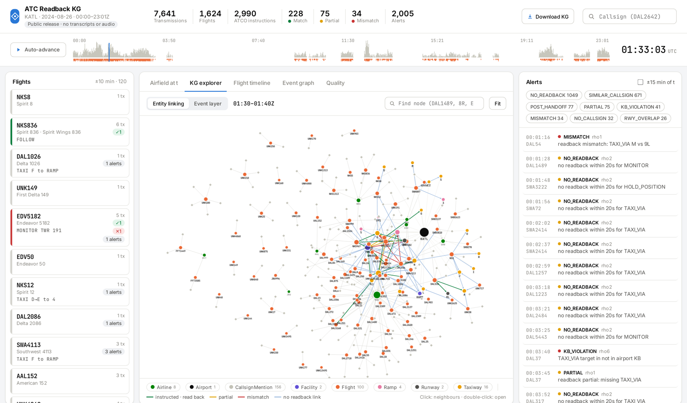
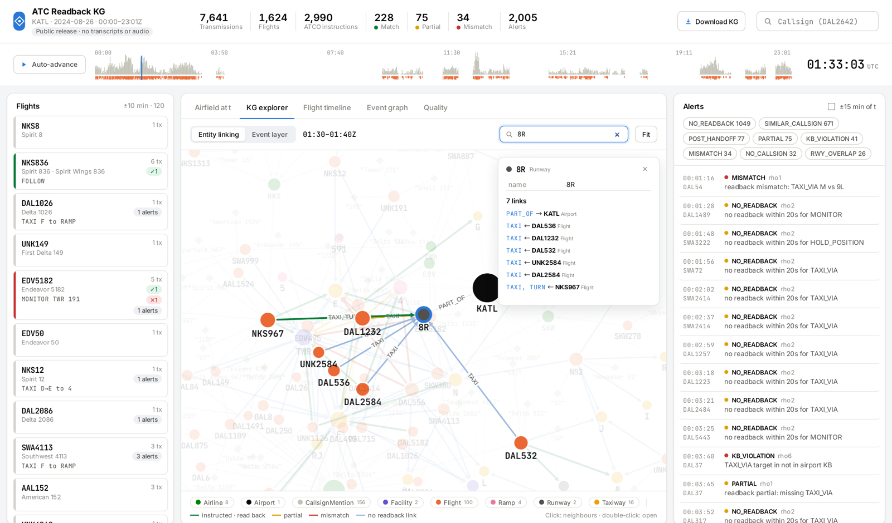
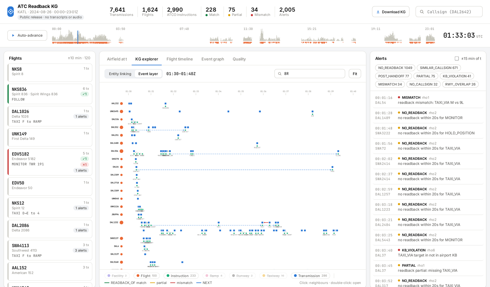
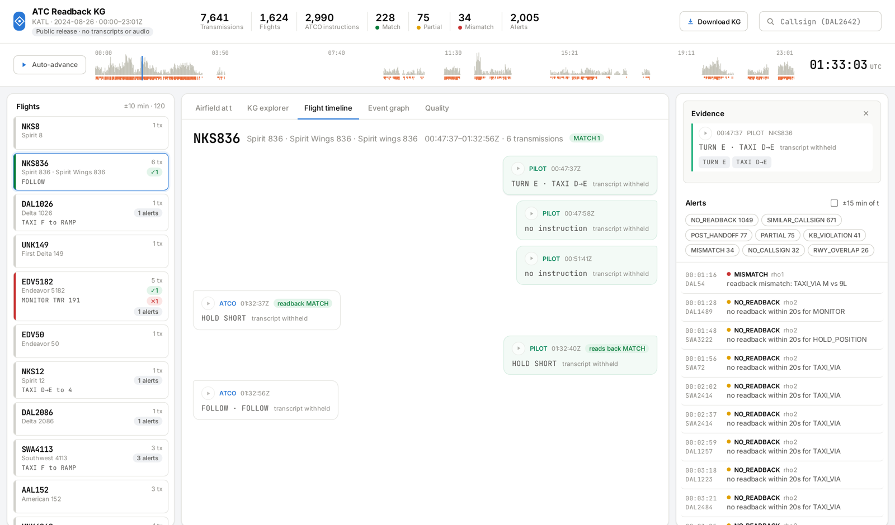
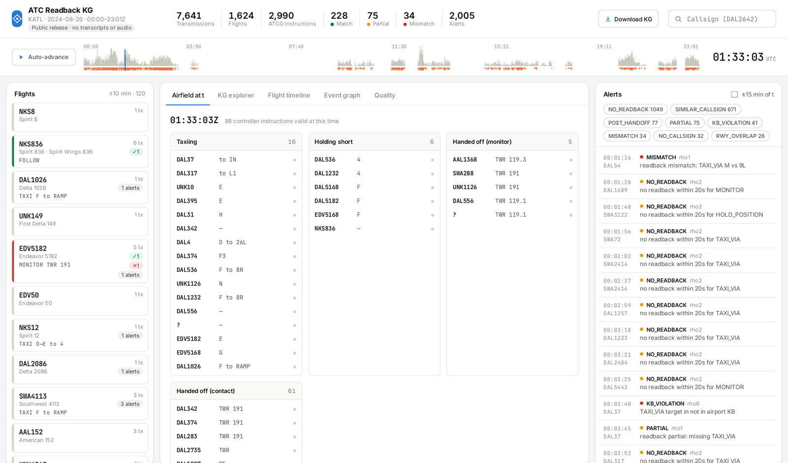
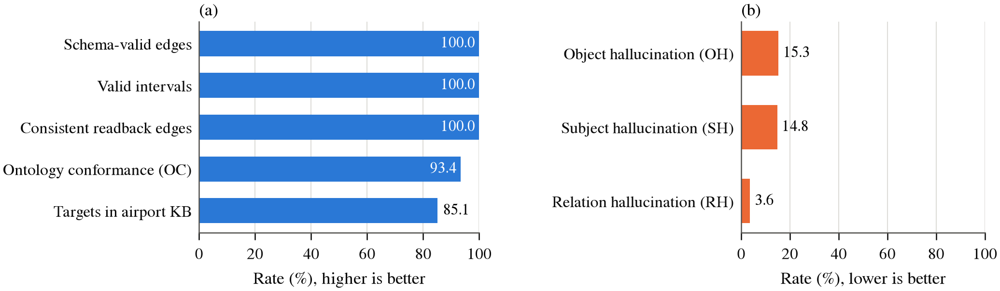
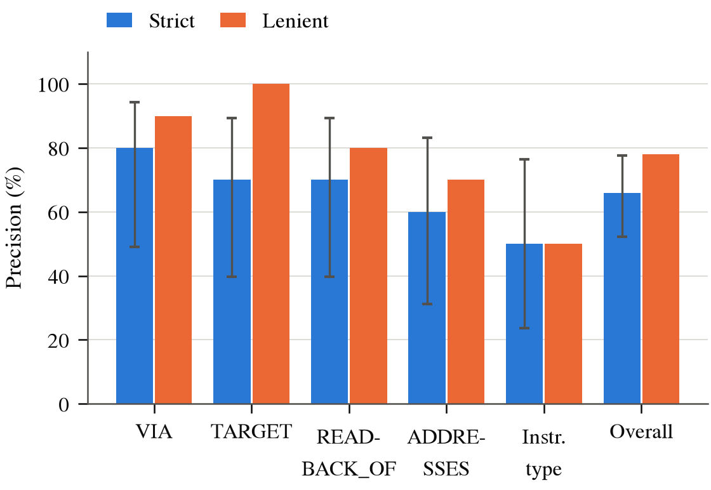
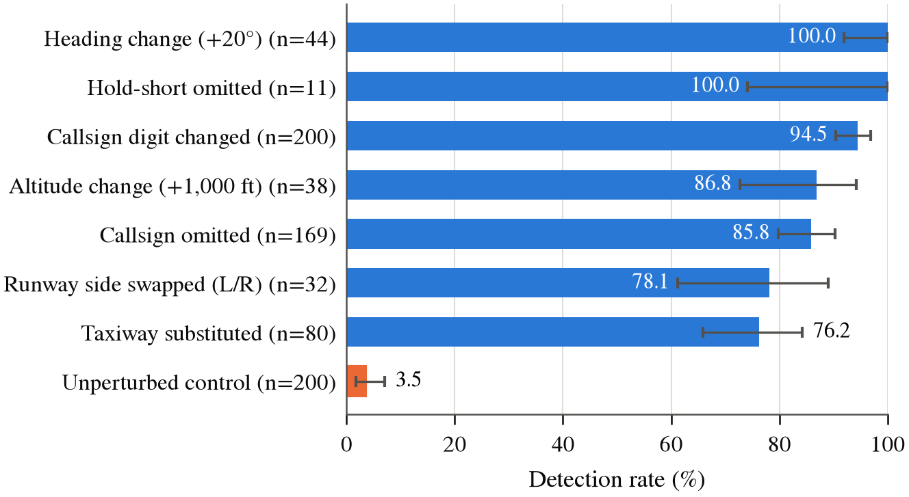
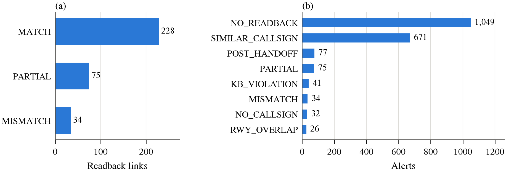

# ATC Readback KG: a temporal knowledge graph of U.S. ATC radio communications

> Team project for **XAI616-00 Knowledge-Based Systems** (Fall 2026, Department of Artificial Intelligence, Korea University), Team 6.

**[Live demo: bigeco.github.io/atc-readback-kg](https://bigeco.github.io/atc-readback-kg/)**

This project turns air traffic control radio recordings (LiveATC) into an **event-centric temporal knowledge graph**.
The graph is then used to check **controller–pilot readbacks** (did the pilot repeat the instruction correctly?)
and to answer **time-aware situational-awareness queries** (which flights hold short of runway 8R at 01:33Z?).

The released graph covers Atlanta (KATL) on 2024-08-26: 38 half-hour archives from ground, approach and departure
frequencies (7,641 transmissions, 1,624 flights, 4,865 instructions, 337 readback links).

[](https://bigeco.github.io/atc-readback-kg/)

## Live demo

The public demo is built from the public KG, so it carries **no audio and no transcripts** (LiveATC terms forbid
redistribution); each transmission shows the instructions extracted from it instead. Audio playback and transcripts
are available in the local server mode (`bash scripts/run_demo.sh`).

| | |
|---|---|
|  |  |
| **KG explorer, entity linking.** Callsign mentions are linked to flights, flights to airlines and to the runways, taxiways, ramps and facilities they were instructed to use (edge colour = readback result), places to the airport. Click a node to see its neighbours and properties. | **KG explorer, event layer.** One row per flight on a 10-minute time axis: transmissions, the instructions they contain, readback links and NEXT links between a flight's successive instructions. |
|  |  |
| **Flight timeline.** Controller and pilot transmissions of one flight with the readback verdict and the evidence panel. | **Airfield at t.** Instructions whose validity interval contains the selected time, grouped by state (taxiing, holding short, handed off), with the rule alerts on the right. |

## Pipeline

| Stage | Module | Code | Output |
|---|---|---|---|
| M0 | Static airport KB (OurAirports + OpenStreetMap) | `src/kb/build_static_kb.py` | `data/static_kb/<icao>.json` |
| KB | Ontology and rule base from the DLR ATC command ontology and FAA JO 7110.65BB | `src/kb/build_ontology.py` | `configs/ontology.json`, `configs/rules.json` |
| M1 | Speech-to-text: MOSS-ATC joint transcription and speaker diarization of whole archives (Whisper large-v3 path also available) | `src/run_asr_moss.py`, `src/run_asr.py` | `data/raw/text/` |
| M2a | Speaker role decision: an LLM labels each diarized speaker ATCO or PILOT, with a callsign-position rule override | `src/pipeline/m2_role.py` | `turns.jsonl` |
| M2b | Ontology-grounded instruction extraction (LLM few-shot + validation against the transmission + rule grammar) | `src/pipeline/m2_extract.py` | `extraction.jsonl` |
| M3 | Entity linking: callsigns to flights and airlines, places to airport KB entities | `src/pipeline/m3_canonicalize.py` | `canonical.jsonl` |
| M4 | Bi-temporal event graph: validity intervals, readback links, supersession | `src/pipeline/m4_graph.py` | `kg/graph.json`, `kg/neo4j/` |
| M5 | Readback comparison and anomaly rules (MISMATCH, PARTIAL, NO_READBACK, NO_CALLSIGN, …) | `src/reasoning/rules.py` | `alerts.json` |
| M6 | Snapshot, timeline and competency queries; web demo | `src/reasoning/queries.py`, `src/demo/` | API + demo |
| M7 | Evaluation E0–E3 | `src/evaluation/` | `results/<run>/eval/` |

### KG schema

- **Event layer** (time-stamped): `Transmission` (speaker, UTC start/end, archive offsets) and `Instruction` (type, value,
  validity interval `[valid_from, valid_to)`).
- **Entity layer**: `Flight` (resolved callsign) and `CallsignMention` (the callsign as spoken).
- **Static KB layer**: `Role`, `Airline` (designator, country), `Airport` (location indicator, country), and the
  instruction targets `Runway`, `Taxiway`, `Ramp`, `Facility`.
- **Edges**: `SPOKEN_BY`, `CONTAINS`, `ADDRESSES`, `ALIAS`, `OPERATED_BY`, `TARGET`, `VIA`, `PART_OF`,
  `NEXT` (successive instructions of a flight) and `READBACK_OF` (pilot transmission → controller transmission,
  status MATCH / PARTIAL / MISMATCH).

## Evaluation

| Goal | Experiment | Result (38-archive KG unless noted) |
|---|---|---|
| (1) KG quality | E0 intrinsic quality without gold labels (Text2KGBench-style) | ontology conformance 93.4%; schema-valid edges, valid intervals and consistent readback edges 100% |
| | E2 precision of sampled facts against the transcript (50 facts, 11-archive KG, provisional single-annotator labels) | 66% strict, 78% lenient |
| (2) Readback recognition | E3 detection of errors injected into correct readbacks | 76–100% per error type, 3.5% false alarms on unperturbed readbacks |
| (3) Situational awareness | E1 competency questions (instruction history, hold-short at t, post-hand-off instructions, state at t) | all answerable and traceable to the source archive and offset |

| | |
|---|---|
|  |  |
| **Figure 1.** (a) Structural quality; (b) hallucination rates of the raw LLM output before validation. | **Figure 2.** Precision by relation; error bars are Wilson 95% CIs. |
|  |  |
| **Figure 3.** Detection rate per injected error type; orange = false alarms on unperturbed readbacks. | **Figure 4.** (a) Readback verdicts; (b) rule alerts. |

**Limitations.** The E2 labels are provisional (one annotator); recall is not measured (no gold instruction set);
E3 injects errors into clean text, so its rates are upper bounds (on real recordings about 42% of sampled MISMATCH
alerts are genuine); E1 checks answerability, not correctness against a gold timeline. Altitudes, headings and
frequencies read as callsigns create spurious flights and inflate NO_READBACK.

## Quick start

```bash
bash scripts/setup_env.sh                       # conda env "atc-kg" (python 3.11, torch cu124)
bash scripts/download_liveatc.sh katl "Gnd"     # or put archives under data/raw/liveatc/<airport>/
bash scripts/build_static_kb.sh KATL
CUDA_VISIBLE_DEVICES=0 python src/run_asr_moss.py --help                        # M1
python src/build_kg.py --run-name katl_moss38 --stt-dir data/raw/text           # M2-M5
RUN_NAME=katl_moss38 bash scripts/run_eval.sh                                   # E1-E3
RUN_NAME=katl_moss38 PORT=8800 bash scripts/run_demo.sh                         # http://127.0.0.1:8800
```

From a laptop, when the demo runs on a remote server: `ssh -L 8800:127.0.0.1:8800 <server>`.

- **Public KG**: `python src/demo/public_kg.py --run-name katl_moss38` writes the graph without transcripts
  (`graph.json`, Neo4j CSV, alerts, README). The live demo offers it as a zip ("Download KG").
- **Static site**: `RUN_NAME=katl_moss38 PUBLISH=1 bash scripts/export_site.sh` builds the public demo and pushes it to `gh-pages`.
- `build_kg.py --extractor rule` runs a GPU-free baseline; `--reuse-roles` and `--reuse-extraction` skip M2a / M2b;
  `--llm-backend openai --llm-base-url http://host:8000/v1` uses an OpenAI-compatible server.

## Layout

```
assets/        README images
configs/       ontology.json, rules.json, kg_build.json, airlines.json, fewshot_examples.json
data/          static_kb/ (committed), ontology/FAA규정.pdf; raw/ (LiveATC audio and transcripts, not committed)
scripts/       setup, download, pipeline, eval, demo, site export
src/           common/ kb/ pipeline/ prompt/ reasoning/ evaluation/ demo/
results/<run>/ generated artifacts (not committed)
```

## Data and licenses

- LiveATC recordings (via the Hugging Face dataset `nyuuzyou/liveatc`) are for **personal, non-commercial use**;
  redistribution needs LiveATC's permission. Audio and transcripts are therefore never committed or published:
  the public KG and demo keep only extracted instructions, readback results, times and the archive name + offsets.
- DLR ATC command ontology documents are not redistributed (no use without DLR's written consent).
  FAA JO 7110.65BB is a U.S. Government work.
- OurAirports data is public domain; taxiway names come from OpenStreetMap (ODbL).
- `configs/airlines.json` is a curated subset of FAA JO 7340.2 telephony designators.
