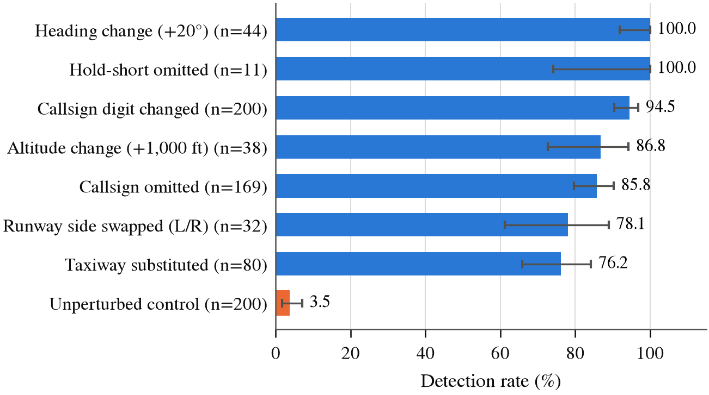
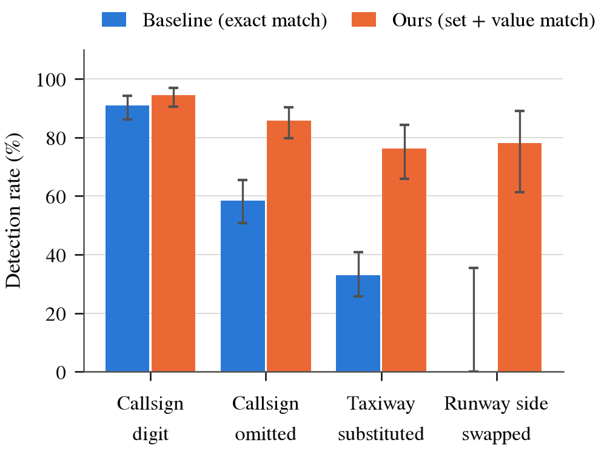
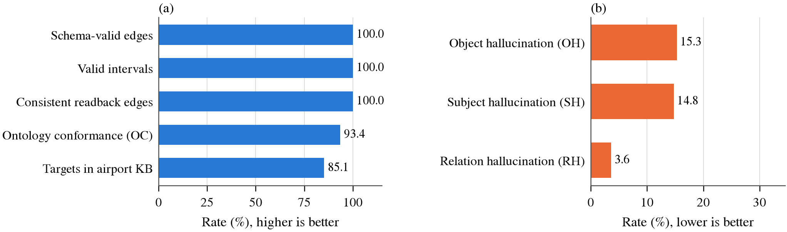

# Results (figures and captions)

All figures: `docs/evaluation/figures/` (PDF for LaTeX, PNG for preview). Regenerate with `python src/evaluation/plot_eval.py`.
Setting unless noted: KATL LiveATC, 2024-08-26, 38 archives (GND 7, APP 19, DEP 12) transcribed and diarized by MOSS-ATC,
7,641 transmissions; extraction with Qwen3-4B-Instruct; KG `results/katl_moss38`.

---

## Figure 1. Readback-error detection under controlled injection (E3)

**Caption.** Detection rate of the readback check for seven error types injected into pilot readbacks that the system
had judged MATCH (200 pairs; text-level injection, same LLM extractor as the KG). The orange bar is the false-alarm rate
on the same readbacks without injection. Error bars: Wilson 95% confidence intervals. Runway-side and taxiway
injections are applied only to pairs whose controller instruction contains a runway side or a taxiway.

**Results.** The check detects heading changes (44/44) and omitted hold-short instructions (11/11) without miss, and
callsign digit changes in 94.5% of cases, while flagging only 3.5% of unperturbed readbacks. Altitude changes (86.8%)
and omitted callsigns (85.8%) are detected in most cases. Spatial substitutions are the hardest: runway-side swaps
(78.1%) and taxiway substitutions (76.2%) are missed when the extractor does not recover the swapped place from the
readback. Because injection operates on clean text, these rates are upper bounds; on real recordings only about 42% of
MISMATCH alerts (8 of 19 sampled, 11 archives) correspond to genuine discrepancies.

---

## Figure 2. Effect of the revised readback comparison (E3)

**Caption.** Detection rate of the baseline (Whisper transcripts, exact target/route match) and of the revised system
(MOSS transcripts, set-based place match grounded in the controller's text, heading/altitude value match) on the four
injection types measured in both runs. Error bars: Wilson 95% CI.

**Results.** The revised comparison raises taxiway-substitution detection from 33% to 76% and runway-side detection
from 0/7 to 78%, and callsign-omission detection from 58% to 86%; callsign-digit detection stays above 90% in both.
The baseline missed spatial errors because a correct readback and a wrong one were extracted with the same
destination/route inconsistency, so exact matching could not tell them apart. Note that the two runs differ in both the
transcription model and the comparison rule, so the gain is not attributable to the comparison alone.

---

## Figure 3. Precision of KG facts against the source transmission (E2)

**Caption.** Precision of five fact types sampled from the KG (10 per relation, 50 in total, 11 archives), judged against
the transcript. Strict: the fact is stated in the transcript; lenient: also accepts a reasonable repair of a recognition
error. Error bars: Wilson 95% CI of the strict precision. Labels are provisional (single annotator, not yet adjudicated).

**Results.** Overall precision is 66% (strict; 95% CI 52-78%) and 78% (lenient). Route (VIA, 80%) and target (TARGET,
70% strict, 100% lenient) facts are the most reliable, which is the information the readback check compares. The
weakest fact type is the instruction type (50%): approach transmissions such as "runway eight left, descend" were
extracted as taxi instructions, and phonetic letters belonging to callsigns ("three eight Alpha") were read as
taxiways. Flight attribution (ADDRESSES, 60%) suffers from frequencies and altitudes read as callsigns. The wide
intervals reflect the small sample.

---

## Figure 4. Intrinsic KG quality without gold labels (E0)

**Caption.** (a) Structural and ontology-level quality: share of edges whose endpoint types match the ontology's
domain/range, instructions with a valid validity interval, readback edges that satisfy the speaker/flight/time
constraints, LLM instructions conforming to the ontology (OC; Text2KGBench), and TARGET/VIA edges pointing to an entity
in the airport KB. (b) Hallucination rates of the raw LLM output before validation: relation (RH, type outside the
ontology), subject (SH, callsign digits absent from the transmission) and object (OH, target or route absent from the
transmission).

**Results.** The KG has no schema or temporal violations (26,670 edges, 4,865 intervals, 337 readback edges), and no
flight holds two mutually superseding states at the same time. The LLM follows the ontology for 93.4% of instructions
and rarely invents an instruction type (RH 3.6%), but 14.8% of its callsigns and 15.3% of its targets are not supported
by the transmission; the validation step of M2b removes these before they enter the KG. 85.1% of instruction targets
resolve to the KATL airport KB; the rest are flagged as KB violations. The 100% rates follow from construction and show
that the graph is well-formed, not that its facts are correct (see Figure 3).

---

## Figure 5. Readback outcomes and alerts in the KATL temporal KG

**Caption.** (a) Status of the 337 readback links (pilot transmission to the preceding controller transmission of the
same flight within 20 s). (b) Alerts raised by the rule layer (M5).

**Results.** Of the linked readbacks, 68% fully match, 22% omit at least one instruction that requires a readback and
10% state a different value or place. NO_READBACK (1,049) and SIMILAR_CALLSIGN (671) dominate the alerts. Both are
inflated by an identified error: altitudes, headings and frequencies read as callsigns create spurious flights (e.g.
"one four thousand" becomes flight DAL1400 with 48 transmissions; UNK180 with 65), which then appear to receive
instructions without readback and to have callsigns one digit apart from real flights. These counts should therefore be
read as upper bounds until the callsign filter is fixed.
