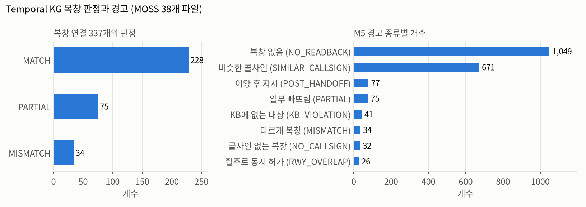
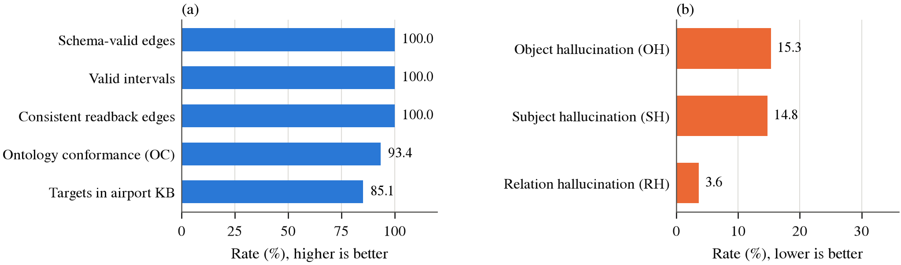
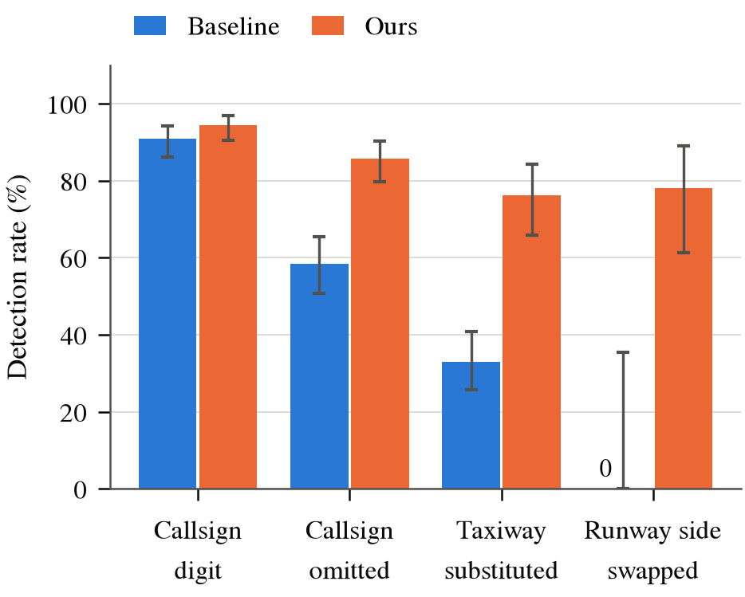

# Temporal KG 구축 결과와 평가 (2026-10-19)

KATL(애틀랜타 공항) LiveATC 녹음을 MOSS-ATC로 전사하고, M2a~M5를 거쳐 Temporal KG를 만든 결과와 평가입니다.
수치는 모두 `results/katl_moss38`(평가 E2만 `results/katl_moss11`)에서 나온 값입니다.

---

## 1. Temporal KG 구축 결과

### 입력 데이터

- **음성 파일: 38개** (30분 녹음, 2024-08-26)
- **송신(tx_id): 7,641개** (파일끼리 겹치는 송신 127개 제거 후)

| 관제 위치 | 음성 파일 | 송신 (중복 제거 전) | 송신 (KG, 중복 제거 후) |
|---|---|---|---|
| GND (지상관제) | 7 | 1,867 | 1,820 |
| APP (접근관제) | 19 | 3,866 | 3,803 |
| DEP (출발관제) | 12 | 2,035 | 2,018 |
| DEL (허가중계) | 0 | 0 | 0 |
| **합계** | **38** | **7,768** | **7,641** |

MOSS로 전사한 60개 중 22개는 결과가 깨져서 제외했습니다.
- 송신 누락 19개: 같은 파일의 Whisper 송신 수의 절반 미만
- 같은 문장 반복 출력 3개

제외한 전사는 `data/raw/text_excluded/`에 보관했고, 허가중계(DEL)는 2개 모두 실패해서 남은 파일이 없습니다.

### 노드와 간선

| 노드 | 개수 | 간선 | 개수 |
|---|---|---|---|
| Transmission | 7,641 | SPOKEN_BY | 7,641 |
| Instruction | 4,865 | CONTAINS | 4,865 |
| Flight | 1,624 | ADDRESSES | 6,552 |
| CallsignMention | 2,039 | ALIAS | 2,138 |
| Airline | 18 | OPERATED_BY | 1,053 |
| 지시 대상 (Runway / Taxiway / Ramp / Facility) | 19 / 138 / 11 / 12 | TARGET / VIA | 1,226 / 905 |
| Airport / Role | 1 / 2 | NEXT | 1,773 |
| | | READBACK_OF | 337 |
| | | PART_OF | 180 |

화자 역할(M2a): ATCO 4,019 / PILOT 3,622

### 복창 판정과 경고



- **복창 연결(READBACK_OF) 337개**: MATCH 228, PARTIAL 75, MISMATCH 34
- **M5 경고**: 가장 많은 것은 NO_READBACK(1,049)과 SIMILAR_CALLSIGN(671)입니다. 이 두 경고는 아래 "알려진 문제"의 가짜 항공편과 화자 판정 오류에 영향을 받습니다.

---

## 2. 평가 항목과 지표

KG 구축·평가 문헌에서 쓰는 지표에 맞춰 평가를 구성했습니다.

| 평가 | 묻는 것 | 지표 | 근거 문헌 |
|---|---|---|---|
| **E0** KG 내재 품질 | 온톨로지·스키마·시간 규칙을 지키나 | 온톨로지 준수율(OC), hallucination(RH/SH/OH), 스키마·시간 일관성 | Text2KGBench (ISWC 2023) |
| **E1** 역량 질문 | KG가 설계한 질문에 답하나 | CQ1~CQ8 답변 가능 여부와 원본 추적 | Grüninger & Fox (1995) |
| **E2** 사실 정밀도 | KG의 사실이 원본 송신과 맞나 | 관계별 표본 정밀도 + Wilson 95% 신뢰구간 | Gao et al. (VLDB 2019), Marchesin & Silvello (VLDB 2024) |
| **E3** 복창 오류 탐지 | 복창 오류를 잡나, 정상 복창을 오류로 보지 않나 | 오류 주입 탐지율 + 대조군 오경보율 | Helmke et al. (DLR, SESAR 2021·2022) |

---

## 3. 평가 결과

### E0. KG 내재 품질 (정답 없이 계산)



| 지표 | 값 | 뜻 |
|---|---|---|
| 스키마 준수 간선 | 100% (26,670개) | 간선 양 끝의 노드 종류가 온톨로지 정의와 맞음 |
| 유효 구간 정상 / 복창 간선 조건 충족 | 100% / 100% | 시작 ≤ 끝, 복창은 조종사 → 직전 관제사, 같은 항공편 |
| 대체된 지시의 동시 유효 | 0건 | 서로 대체되는 지시가 같은 시간에 유효한 경우 없음 |
| 온톨로지 준수율 (OC) | **93.4%** | LLM이 낸 지시 중 종류·대상 규칙에 맞는 비율 |
| KB에 있는 대상 | 85.1% | 지시 대상이 KATL 활주로·유도로 목록에 있음 |
| 관계 / 콜사인 / 대상 hallucination | 3.6% / 14.8% / 15.3% | 검증 전 LLM 원 출력 기준. M2b 검사 단계에서 상당수 걸러짐 |

구조(스키마·시간)는 깨지지 않습니다. 다만 이 100%는 코드가 규칙대로 만들기 때문에 나오는 값이라, "KG가 정확하다"는 근거는 아니고 "구조가 깨지지 않았다"는 근거입니다.

### E1. 역량 질문

**8개 중 8개 답변**, 모든 답이 원본 음성 파일과 구간까지 추적됩니다.

| CQ | 질문 | 답 개수 |
|---|---|---|
| CQ1 | 항공편이 받은 지시를 시간순으로 | 48 |
| CQ2 | 특정 유도로에서 대기(hold short) 지시를 받은 항공편 | 13 |
| CQ3 | 복창이 없거나 콜사인 없이 복창된 지시 | 1,081 |
| CQ4 | 복창과 지시의 유도로·활주로가 다른 경우 | 34 |
| CQ5 | STT 교정이 개입된 콜사인 | 97 |
| CQ6 | 공항 KB에 없는 유도로·활주로 | 95 |
| CQ7 | 관제탑으로 넘긴 뒤에도 지상관제 지시를 받은 항공편 | 77 |
| CQ8 | 시점 t에 유효한 지상 상태 | 124 |

E1은 "답이 나오는가"만 보고, 답이 맞는지는 보지 않습니다. 실제로 CQ1의 예시 항공편 DAL1400은 아래 "알려진 문제"의 가짜 항공편입니다.

### E2. 사실 정밀도 (표본 50개)


| 관계 | 엄격 | 관대 |
|---|---|---|
| VIA (경로) | 80% | 90% |
| TARGET (지시 대상) | 70% | 100% |
| READBACK_OF (복창 연결과 판정) | 70% | 80% |
| ADDRESSES (항공편) | 60% | 70% |
| 지시 종류 | **50%** | 50% |
| **전체** | **66%** (95% CI 52~78%) | **78%** (95% CI 65~87%) |

- **잠정치입니다.** 라벨은 Claude가 원문을 읽고 단 것이고, 표본이 관계별 10개라 신뢰구간이 넓습니다. 팀원 확인이 필요합니다(`results/katl_moss11/eval/e2_audit_sheet.csv`).
- 가장 약한 것은 **지시 종류(50%)**입니다. 이후 M2b를 고쳐서(아래 4절), 이 표본의 틀린 5건 중 2건은 제거됐습니다.

### E3. 복창 오류 탐지 (오류 주입)


정상으로 판정된 복창 200쌍에 오류를 하나씩 넣고, 시스템이 잡는지 측정했습니다. 실제 시스템과 같은 LLM 추출기를 썼습니다.

| 주입한 오류 | 탐지율 | n |
|---|---|---|
| 정상 복창 (대조군) → 오경보 | **3.5%** | 200 |
| 방위 변경 (+20°) | 100% | 44 |
| hold short 빠뜨림 | 100% | 11 |
| 콜사인 숫자 바꿈 | 94.5% | 200 |
| 고도 변경 (+1,000ft) | 86.8% | 38 |
| 콜사인 빠뜨림 | 85.8% | 169 |
| 활주로 좌우 바꿈 (L↔R) | 78.1% | 32 |
| 유도로 바꿔치기 | 76.2% | 80 |



이전 실행(Whisper 전체, 이전 비교 규칙)보다 크게 좋아졌습니다. 유도로 바꿔치기는 33% → 76%, 좌우 바꿈은 0/7 → 78%입니다. 다만 두 실행은 STT 모델(Whisper → MOSS), 복창 비교 규칙, 주입 방식(이전에는 유도로가 없는 쌍에도 주입했고 콜사인 단어 "Delta"를 "Victor"로 바꾼 경우도 셌음)이 모두 달라서, 향상분 전체를 비교 규칙의 효과로 볼 수는 없습니다. 오경보는 이전 0/200, 현재 3.5%입니다.

**주의 1: 상한값입니다.** E3는 전사 오류가 없는 텍스트에 오류를 넣는 방식입니다. 실제 녹음에서 MISMATCH 경고를 직접 확인해 보면, 실제 오류인 비율은 **약 42%**(11개 파일, 19건 중 8건)입니다. 나머지는 STT와 추출 오류로 생긴 오경보입니다.

**주의 2: 비교 대상.** DLR 연구(Helmke et al., SIDS 2022)는 실제 운영 녹음에서 복창 오류 81% 탐지, 인위 사례 오경보 11%를 보고했습니다. 데이터와 정답 조건이 달라 직접 비교는 할 수 없습니다.

---

## 4. 오늘 반영한 주요 수정

| 수정 | 효과 |
|---|---|
| TAXI_VIA 복창 비교를 장소 집합 + 관제사 원문 기준으로 | 실제 녹음 MISMATCH 56 → 19 (11개 파일), 실제 오류 비율 20% → 42% |
| 콜사인·ATIS의 음성 알파벳은 유도로로 보지 않음 + 접근·출발관제에서 TAXI_VIA 제외 | 틀린 TAXI_VIA 117개 감소, 실제 오류 탐지는 유지 |
| HEADING 근거 단어 보완 ("turn right, three six zero") | 접근·출발관제 복창 연결 18 → 22 (11개 파일) |
| 방위·고도 값 비교 + 원문에서 값 읽기 | E3 방위 변경 100%, 고도 변경 86.8% 탐지. LLM의 고도 값 오류("one four thousand" → 1400)로 생긴 오경보 15 → 2 |
| 숫자 단어 변환 수정 ("zero.", "twenty four twenty five") | 콜사인·방위·고도 인식 개선 |

---

## 5. 알려진 문제와 다음 할 일

1. **방위·고도·주파수를 콜사인으로 읽는 가짜 항공편**: 출발관제 복창 "One four thousand, Delta 339"에서 고도 "one four thousand"를 콜사인 1400으로 읽어 가짜 항공편 DAL1400(송신 48개)이 생겼습니다. 같은 이유로 UNK180(65), UNK191(52, 주파수 119.1), UNK170, UNK070(방위) 같은 가짜 항공편이 있습니다. 조종사 복창이 이렇게 엉뚱한 항공편에 묶이면 원래 항공편에는 NO_READBACK 경고가 남습니다(NO_READBACK 1,049건 중 약 276건이 이 경우로 추정). SIMILAR_CALLSIGN 671건 중 가짜 항공편이 관련된 것은 2건뿐이고, 대부분은 같은 항공사 콜사인끼리 숫자 하나 차이(예: DAL342와 DAL348)로 걸린 힌트입니다. **다음에 고칠 1순위**입니다(M2b 검사 단계에서 지시 값과 같은 숫자는 콜사인에서 제외).
2. **지시 종류 추출(M2b)**: E2 지시 종류 정밀도 50%. 규칙 보충이 음성 알파벳만 보고 TAXI_VIA를 붙이는 문제는 일부 고쳤지만 남아 있습니다.
3. **정답 데이터 없음**: 전사 정확도(WER), 화자 역할 정확도, 지시 추출의 재현율을 재지 못했습니다. 송신 50~100개 정도의 정답 세트가 있으면 측정할 수 있습니다.
4. **상황 인식의 범위**: 상황 인식은 "지시로 주어진 상태"입니다. 감시 데이터가 없어 항공기의 실제 위치는 알 수 없습니다.

---

## 6. 재현 방법

```bash
python src/build_kg.py --run-name katl_moss38 --stt-dir data/raw/text --airport katl
python src/evaluation/e0_intrinsic.py --run-name katl_moss38
python src/evaluation/e1_competency.py --run-name katl_moss38
python src/evaluation/e3_error_injection.py --run-name katl_moss38 --extractor llm
python src/evaluation/plot_eval.py
```

참고 문헌
- Mihindukulasooriya et al., Text2KGBench, ISWC 2023 — https://arxiv.org/abs/2308.02357
- Gao et al., Efficient Knowledge Graph Accuracy Evaluation, PVLDB 12(11), 2019
- Marchesin & Silvello, Efficient and Reliable Estimation of Knowledge Graph Accuracy, PVLDB 17, 2024
- Helmke et al., Readback Error Detection by ASR and Understanding, SESAR Innovation Days 2022 — https://publications.idiap.ch/attachments/papers/2022/Helmke_SIDS2022_2022.pdf
- Grüninger & Fox, Methodology for the Design and Evaluation of Ontologies, 1995
